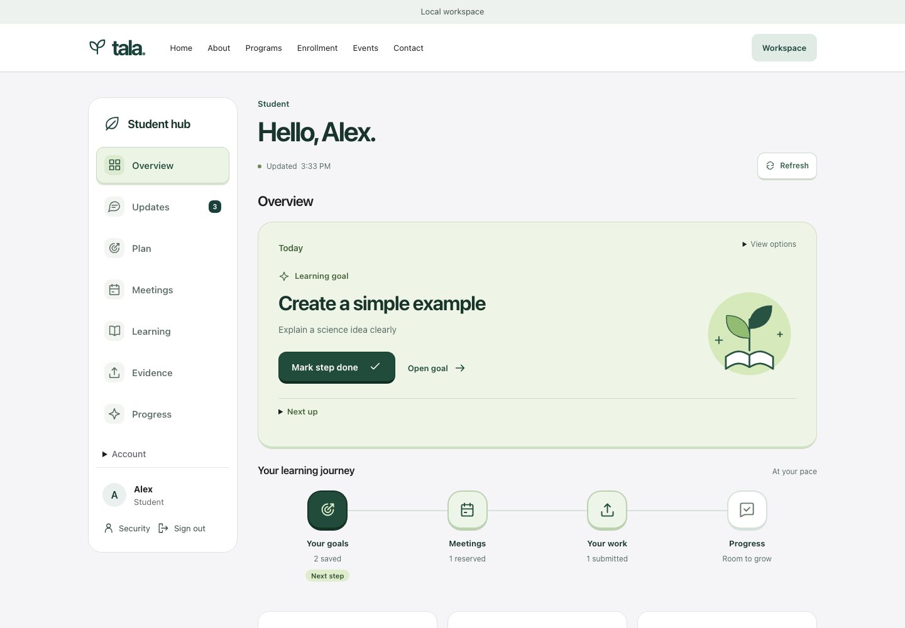

# TALA Hub

React and TypeScript frontend with an independent Node.js API, SQLite database and private file storage. The default application does not require Firebase or a cloud account.

## Screenshots

Captured from the local application using fictional accounts and files.



[Learning plan](project/screenshots/learning-plan.png) · [Meetings](project/screenshots/meetings.png) · [Evidence](project/screenshots/evidence.png) · [Mobile workspace](project/screenshots/student-mobile.png) · [HubSpot payments](project/screenshots/tala-hubspot-payments.png)

## Install and run

Use **Node.js 24 or newer**.

```sh
npm ci --prefix frontend
npm run dev --prefix frontend
```

Open **http://127.0.0.1:5173/#/register**. The launcher starts the website on port 5173 and the API on port 8787, and checks an existing API before reusing it. Ctrl+C stops the processes it started. No `.env` file is required; example environment files contain public placeholders only.

## Current functionality

- Interest-first registration: no account or password until Tina records the interview and approves an application. Optional private documents, saved interview reservations, audited admissions review and expiring one-use invitations create a parent account. Existing accounts retain login, logout and account security. Passwords use scrypt; sessions use HttpOnly cookies and mutations require CSRF protection. Email ownership verification, email recovery and MFA are not connected.
- Student sidebar with an Overview, Today tasks, updates, learning plans, meetings, learning records, Evidence and progress. Counts and records come from saved data.
- Calendar with Month, Week, Day and Agenda views, date navigation, teacher/topic/grade/attendance filters, saved meetings and goal dates. Open Classes shares persistent requests, seat counts and status with Calendar, Overview and Progress. Practice fixtures appear only in explicitly enabled previews with an empty local catalog.
- Staff-published local classes with Online/In Person choices, safe versioned editing, private roster CSV, duplicate prevention, capacity and FIFO waiting lists. Students can save classes for later, review full request history, and change a pending request without losing its queue position. Linked authorized parents approve or decline requests; free classes confirm, paid classes remain pending payment. No browser or operator endpoint can mark a payment paid. Cancelling or declining a seat promotes the next waiting request to parent review.
- Staff-published availability with student booking, rescheduling and cancellation. A reservation does not create a Zoom meeting or prove attendance.
- Private text/PDF Evidence up to 5 MiB from saved meetings or the student’s own confirmed classes that have started, written reflections, revision history and manual staff review. Private reflection drafts can be explicitly saved and resumed after signing in; drafts do not count as submitted Evidence.
- Personal goals, preparation notes and learning progress. Goal completion is self-reported; staff notes and review counts do not represent AI assessment or academic credit.
- Parent read-only access to a linked student's permitted records, plus narrowly scoped class approval, after an operator records an approved family connection. A connection is not proof of legal guardianship.

Accounts, sessions and application records persist in ignored `server/.runtime/tala.sqlite`; uploaded files stay under the same private runtime directory. `TALA_DATA_DIR` selects another directory. Data survives refresh, sign-out and server restart, but is stored on this machine with no cloud synchronization. Selected files and unsaved writing remain in memory until submitted or explicitly saved as a reflection draft.

## Admin page

`/#/admin` lets allowlisted TALA admins draft, publish, unpublish and delete events and opportunities (Firebase Auth, Firestore `tala_drafts` and `jobs`, Storage `tala_uploads`). Set the `VITE_FIREBASE_*` values from `frontend/.env.example`; rules and schema are in [docs/firebase-rules-snippet.md](docs/firebase-rules-snippet.md).

## Project structure

```text
frontend/src/
  public-site/   public pages
  onboarding/    Contact me form, public open times
  product/       signed-in app and admin tools
  api/           API client
  admin/         Firebase-backed events and opportunities admin
  shared/        layout, header, form controls, styles
  authentication/ registration/ payment/ classes/ dashboard/   demo screens
server/          local API (see server/README.md)
docs/            onboarding flow map; sign-in and data model proposal
legacy/          original one-page site
```

The schema 8 upgrade verifies a private SQLite backup before upgrading an older database. Admissions documents are private SQLite data and included in verified backups. See [server/README.md](server/README.md) for local backup, restore and operator commands, and [server/contract.json](server/contract.json) for API contracts.

## Local operator setup

For a new local runtime, explicitly create a fictional admissions administrator:

```sh
node server/operator.cjs create-test-operator --email tina@example.test --name "Tina local test"
```

The command prints a generated test password once and never overwrites an account. Sign in, open Admissions, and publish an interview time. In a separate browser profile, open `/register`, submit a fictional interest form and book the interview. Record the fictional interview as staff, approve it, copy its invitation, and open that link in the parent's browser to create the parent account. No email or real meeting is sent. After parent enrollment, Admissions staff can authorize a seven-day student setup. The signed-in enrolled parent sets separate student credentials and confirms family access; the student account and family link are created together. No public registration or email match bypasses this approval. Additional family links still require separate authorized staff decisions; accounts are never merged automatically by email.

## Checks and service limits

```sh
npm run check --prefix server
npm run lint --prefix frontend
npm run build --prefix frontend
```

For an isolated product review, run `npm run dev:review --prefix frontend`. It starts localhost:5181 with a new temporary fictional runtime on API port 8791, leaves the normal runtime untouched, and writes generated review account instructions into that private temporary directory. The student demo needs no password; review staff can authorize Sam’s setup from Admissions.

The earlier visual demo remains available through `npm run dev:demo --prefix frontend`. Its identities, availability and payments are fixtures. Legacy Firebase tooling is opt-in and separate from the default independent backend.

HubSpot's official quarterly and individual-session Checkout links are connected to staff-authorized, persisted payment items in the family portal. Automatic receipt verification still requires authorized server API access and exact receipt-to-item reconciliation; a return URL never proves payment. The legacy visual demo remains separate. See [HubSpot Payments](server/HUBSPOT-PAYMENTS.md) for the implemented boundary, Sponsor confirmations and transaction-free local testing.

Zoom, email delivery/recovery, production MFA and AI assessment remain unconnected. The server binds to loopback and refuses production mode until hosting, HTTPS, recovery, backups and privacy controls are reviewed. Use invented accounts and files; real minors' records, medical information and recordings require sponsor-approved collection and access policies. These commands do not deploy the application.
