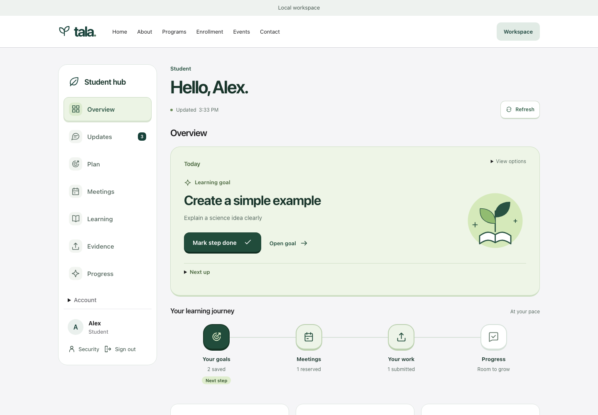

# TALA Hub

React and TypeScript frontend with an independent Node.js API, SQLite database and private file storage. The default application does not require Firebase or a cloud account.

## Screenshots

Captured from the local application using fictional accounts and files.



[Learning plan](project/screenshots/learning-plan.png) · [Meetings](project/screenshots/meetings.png) · [Evidence](project/screenshots/evidence.png) · [Mobile workspace](project/screenshots/student-mobile.png)

## Install and run

Use **Node.js 24 or newer**.

```sh
npm ci --prefix frontend
npm run dev --prefix frontend
```

Open **http://127.0.0.1:5173/#/register**. The launcher starts the website on port 5173 and the API on port 8787, and checks an existing API before reusing it. Ctrl+C stops the processes it started. No `.env` file is required; example environment files contain public placeholders only.

## Current functionality

- Server-backed student and parent registration, login, logout and account security. Passwords use scrypt; sessions use HttpOnly cookies and mutations require CSRF protection. Email ownership verification, email recovery and MFA are not connected.
- Student sidebar with an Overview, Today tasks, updates, learning plans, meetings, learning records, Evidence and progress. Counts and records come from saved data.
- Staff-published availability with student booking, rescheduling and cancellation. A reservation does not create a Zoom meeting or prove attendance.
- Private text/PDF Evidence up to 5 MiB, written reflections, revision history and manual staff review. Private reflection drafts can be explicitly saved and resumed after signing in; drafts do not count as submitted Evidence.
- Personal goals, preparation notes and learning progress. Goal completion is self-reported; staff notes and review counts do not represent AI assessment or academic credit.
- Parent read-only access to a linked student's permitted records after an operator records an approved family connection. A connection is not proof of legal guardianship.

Accounts, sessions and application records persist in ignored `server/.runtime/tala.sqlite`; uploaded files stay under the same private runtime directory. `TALA_DATA_DIR` selects another directory. Data survives refresh, sign-out and server restart, but is stored on this machine with no cloud synchronization. Selected files and unsaved writing remain in memory until submitted or explicitly saved as a reflection draft.

The schema 5 upgrade verifies a private SQLite backup before upgrading an older database. See [server/README.md](server/README.md) for local backup, restore and operator commands, and [server/contract.json](server/contract.json) for API contracts.

## Local operator setup

Register an invented account first, then promote that existing local account:

```sh
node server/operator.cjs promote --email existing@example.test
```

Sign out and back in to publish availability, learning notes and manual reviews. Operator permissions cannot be granted through a registration role selector.

## Checks and service limits

```sh
npm run check --prefix server
npm run lint --prefix frontend
npm run build --prefix frontend
```

The earlier visual demo remains available through `npm run dev:demo --prefix frontend`. Its identities, availability and payments are fixtures. Legacy Firebase tooling is opt-in and separate from the default independent backend.

Zoom, email delivery/recovery, production MFA, AI assessment and real payments are not connected. The payment interface is a preview and makes no charge. The server binds to loopback and refuses production mode until hosting, HTTPS, recovery, backups and privacy controls are reviewed. Use invented accounts and files; real minors' records, medical information and recordings require sponsor-approved collection and access policies. These commands do not deploy the application.
